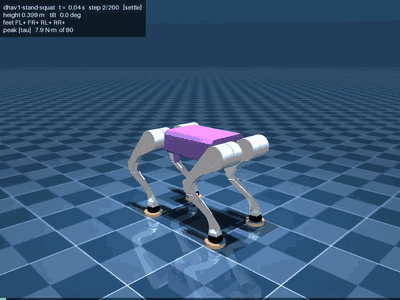
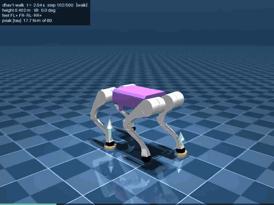
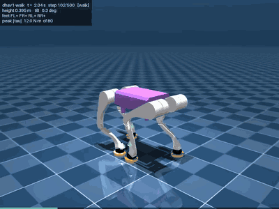
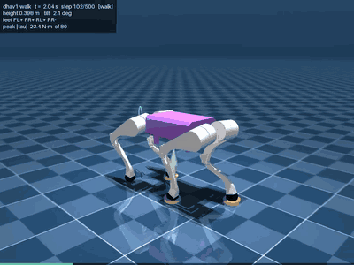
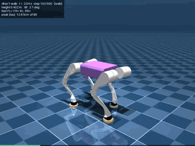
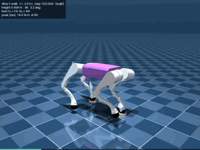
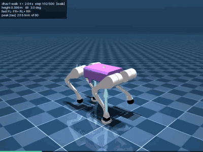
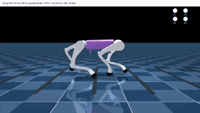
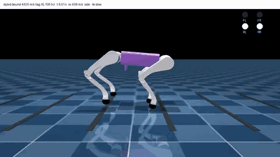
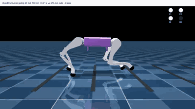

# trajopt

Trajectory optimisation for quadrupeds. trajopt plans a motion with Crocoddyl and Pinocchio, runs it in
MuJoCo on the robot's compiled model with its servo gains, motor torque-speed limits and contact model, and
accepts the result only if the executed rollout passes physical checks. The output is that recorded rollout,
not the plan.

## How it works

1. **Plan.** Crocoddyl optimises the motion on a Pinocchio model of the robot over a contact schedule (stance,
   trot, pace, ...), with friction-cone and joint-limit costs. Walking optimises the position-servo commands
   directly, through a model of the servo and its torque limit. Stand-squat optimises joint torques under
   speed-dependent motor bounds and converts them to servo commands.
2. **Execute.** MuJoCo runs the commands on the robot's compiled model at its control rate, with the plan's
   Riccati feedback by default, and applies the motor torque-speed limit at every physics step.
3. **Check.** Gates check the executed rollout: torque and torque-speed limits, commands, joint limits, simulator
   warnings, body contact, the final hold (height, tilt, pose, speed, support, foot slip and penetration), and
   motion-specific checks such as distance walked.
4. **Save.** The rollout is written as a bundle with hashes and provenance. `replay` reruns the saved commands
   in a fresh process and must reproduce the recording (1 mm, 1 mrad, the same commands and contacts).

## What works

| motion | command | DHAV1 | Go2 |
|---|---|---|---|
| stand and squat | `solve stand-squat` | accepted | accepted |
| walking, default trot | `solve walk` | accepted | accepted |
| walking, other gaits | `solve walk --gait crawl\|walk\|pairs\|pace` | crawl and walk accepted; pairs and pace rejected | not tested |
| dog-style walking | `solve walk --dog-style data/dog/dog-gait-model.json [--dog-gait ...]` | walk, pace and trot accepted; gallop rejected | default gait accepted |
| stairs | `solve stairs` | needs a plant with a staircase; the example plants are flat | |
| belly-up getup | `solve getup-belly-up` | rejected: rights itself but does not reach a four-foot stand | not tested |

DHAV1, rendered from the fresh-process replay of each accepted bundle (`replay --video`; click a clip for the
full mp4). The overlay shows time, base height, tilt, loaded feet and peak torque.

| stand and squat | trot | crawl | walk |
|---|---|---|---|
| [](out/videos/dhav1-stand-squat.mp4) | [](out/videos/dhav1-walk.mp4) | [](out/videos/dhav1-gait-crawl.mp4) | [](out/videos/dhav1-gait-walk.mp4) |

| dog-style walk | dog-style pace | dog-style trot |
|---|---|---|
| [](out/videos/dhav1-walk-dog.mp4) | [](out/videos/dhav1-gait-dog-pace.mp4) | [](out/videos/dhav1-gait-dog-trot.mp4) |

Fast gaits on DHAV1's training plant (without the sensor head), 4x slow motion. These periodic strides come from an
internal stride solver that is not part of this repository.

| flying trot | bound | gallop |
|---|---|---|
| [](out/videos/dhav1-flying-trot.mp4) | [](out/videos/dhav1-bound.mp4) | [](out/videos/dhav1-gallop.mp4) |

Two example robots are included. Each config fetches its model at a pinned commit, and trajopt compiles it:

- **DHAV1**, a 17.8 kg point-foot quadruped from [xterra_robots](https://github.com/xterra-robotics/xterra_robots),
  with a generic motor law from its published actuator rating.
- **Unitree Go2**, from [MuJoCo Menagerie](https://github.com/google-deepmind/mujoco_menagerie).

## Quick start

Python 3.13 and git. Tested on macOS arm64.

```bash
python3.13 -m venv .venv
.venv/bin/python -m pip install -r requirements-solver.txt
.venv/bin/python -m pip install --no-deps -e .

.venv/bin/python -m trajgen.build_plant robots/dhav1.toml                     # fetch and compile the plant
.venv/bin/python -m trajgen.pipeline solve stand-squat --out out/bundles/dhav1-stand-squat   # a few seconds
.venv/bin/python -m trajgen.pipeline replay out/bundles/dhav1-stand-squat
.venv/bin/python -m trajgen.pipeline solve walk --out out/bundles/dhav1-walk                 # about 15 s
```

For Go2, build `robots/go2.toml` and add `--robot robots/go2.toml` to `solve`. `solve` prints every gate and
also writes a bundle that fails, with the suffix `-REJECTED`, so it can be inspected. Bundles are never
overwritten, so use a new `--out` path for each solve. For a
video, install `requirements-video.txt` and add `--video out/clip.mp4` to `replay`.

MuJoCo is pinned to exactly 3.11.0, so a clip replays on the same physics it was solved with. Crocoddyl 3.1.0 and
Pinocchio 3.8.0 are pinned because Crocoddyl 3.2.1 with Pinocchio 4.1.0 segfaulted in contact solves.
`requirements-solver.lock` has the same versions with hashes for macOS arm64.

## Output

- `clip.json`: the executed motion, frame by frame (`qpos`, `qvel`, servo command `ctrl`, foot contacts), and
  the parameters it was solved with;
- `arrays.npz`: the full MuJoCo state at the start, the commands, the executed states and physics-rate
  samples (stand-squat also stores the planned states, torques, feedback gains and contact forces);
- `manifest.json`: provenance (plant, config and code hashes), every gate result, and the replay agreement.

A bundle whose files do not match its hashes is refused on load.

## Uses

**Policy training.** Accepted clips replay exactly on the robot's compiled model from their recorded initial
state, so they can serve as references for imitation or motion-tracking rewards on that model.
`trajgen.pipeline dataset --out DIR BUNDLES...` combines accepted bundles with the same plant and stepping into one
dataset.

**Motion capture.** A capture is not used as a trajectory but as a target for the planner. `tools/dog/` fits a
gait model to dog BVH captures. `--dog-style` takes contact timing, swing paths, footholds and trunk motion from
it, Froude-scaled to the robot's standing leg-root height, and the result goes through the normal walking checks.
For a clip already retargeted to the robot, `trajgen.motions.ff_commands` estimates load-compensating servo
commands by inverse dynamics and clips them to the joint ranges. It does not check feasibility or tracking.

## Adding a robot

Copy `robots/dhav1.toml` or `robots/go2.toml`. A config names the plant and its MJCF or URDF, the servo gains
and timestep, the motor torque-speed law, foot friction and the stand pose. Unknown keys are an error. With a
`[build]` section, `trajgen.build_plant` makes the plant from the robot's torque-motor MJCF. It replaces each
motor with a position servo, sets the timestep, settles a `stand` keyframe and writes a provenance file. If you
already have a compiled `.mjb`, point `[model].mjb` at it instead. It is checked against the config on
every load.

The code expects four legs `FL FR RL RR` with joints `{leg}_{hip,thigh,calf}_joint` and actuators
`{leg}_{hip,thigh,calf}`, one collision sphere per foot (or a held wheel), and a free-joint base. The Pinocchio description must
match the plant's bodies, masses and inertias, which is checked at random poses.

## Tests

After the quick start. For another robot, give the smoke test `ROBOT=robots/<robot>.toml`, `test_pipeline` a
bundle path, and the adapter and bridge tests `--robot`.

```bash
.venv/bin/python tests/smoke_solver.py                                    # 5/5
.venv/bin/python tests/test_adapter.py                                    # 22/22
.venv/bin/python -m unittest discover -s tests -p test_servo_physics.py
.venv/bin/python tests/test_pipeline.py                                   # 57/57
.venv/bin/python tests/test_bridge.py                                     # 7/7
```

## Layout

`trajgen/` is the package: planning (`croc.py`, `gait.py`), execution (`execution.py`, `plant.py`,
`servo.py`), gates (`gates.py`), bundles (`bundle.py`, `dataset.py`), the plant builder (`build_plant.py`) and
the motions (`motions/`). `robots/` holds the robot configs. `data/dog/` holds the dog gait model and
`tools/dog/` the code that fits it. Plants, bundles and videos go to `out/`, which is not tracked (except the README videos in `out/videos/`).

## Licence

Apache-2.0 (`LICENSE`), with third-party notices in `NOTICE`. The dog gait model in `data/dog/` comes from the
AI4Animation MANN dog motion capture and is **CC BY-NC 4.0, non-commercial only**. Motions made with
`--dog-style` carry that restriction. The robot models are fetched, not redistributed: DHAV1 is BSD-3-Clause
(xTerra Robotics) and Go2 is BSD-3-Clause (Menagerie).
